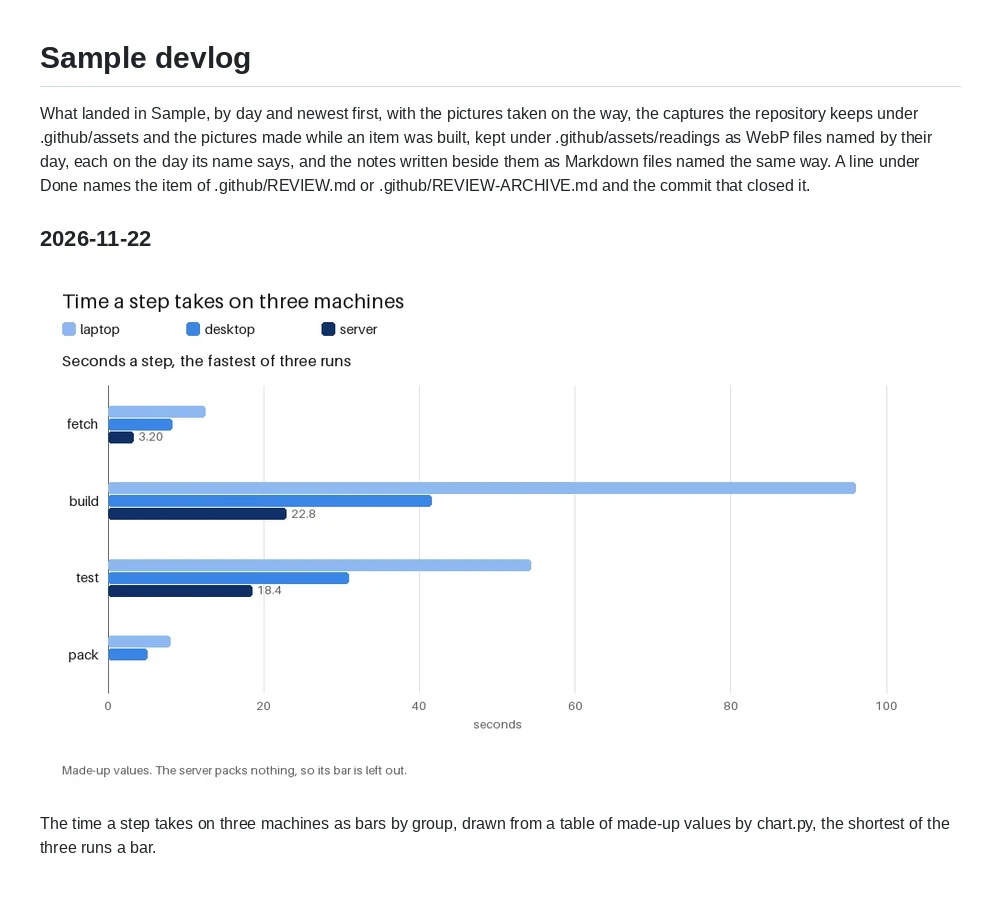
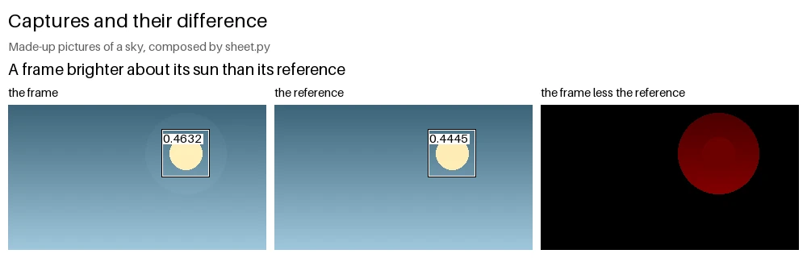
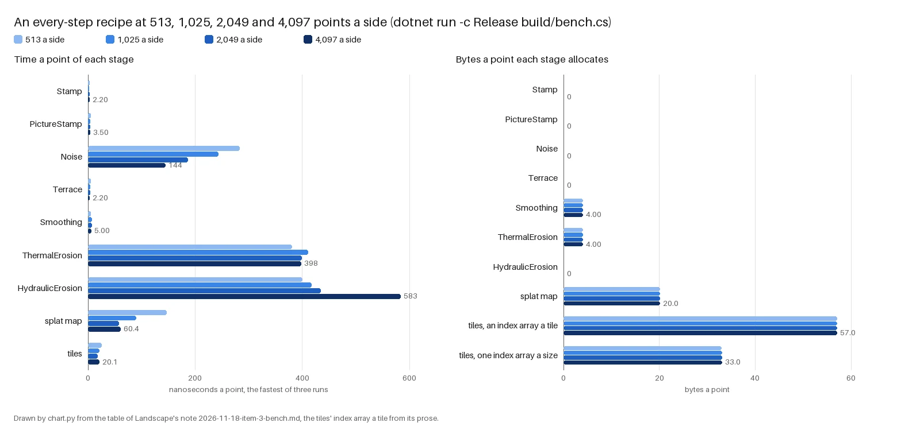
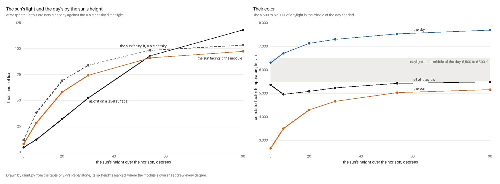

# Tools devlog

What landed in Tools, by day and newest first, with the pictures taken on the way, the captures the
repository keeps under `.github/assets` and the pictures made while an item was built, kept under
`.github/assets/readings` as WebP files named by their day, each on the day its name says, and the
notes written beside them as Markdown files named the same way. A line under Done names the item of
.github/REVIEW.md or .github/REVIEW-ARCHIVE.md and the commit that closed it.

## 2026-11-22

A page of a made-up repository's devlog as devlog.py writes it, a day's heading over a chart that
chart.py drew and the line that captions it.

A sheet the composer made of two made-up pictures of a sky, the mean luminance read inside the box
over the sun, and the first less the second on black, red where the first is brighter.

## 2026-11-18

The sheet composer's first sheet, from 3DEngine's captures of a room lit by its lamps' faces at the
gain that puts the path-traced reference's mean at 0.18, the box over the floor reading 0.0005032
with the shading floor on and off and 0.0004174 path traced, and the frame with the floor off less
the reference on black, red where brighter and blue where darker, full at half the reference's mean.

Landscape's sheet of its every-step bench drawn again by chart.py from the table of its note alone,
the time a point and the bytes a point of each stage at four sizes as bars by group, the same values
and order as the sheet its session drew by a script of its own.

Sky's sheet of the sun's light and the day's by the sun's height drawn again by chart.py from the
six heights of the table in Sky's Reply alone, the light in thousands of lux and the colors in
kelvin with daylight's 5,500 to 6,500 K shaded, each label clear of its line, where the module's own
sheet drew every degree and a series of the molecules at the primaries' wavelengths that the table
does not hold.

## 2026-10-31

Done that day

- Item 1 at `e28b3b4`. The documents, one commit.
- Item 2 at `13c8202`. The skeleton, one commit after item 1.
- Item 3 at `321de49`. The code's move.
