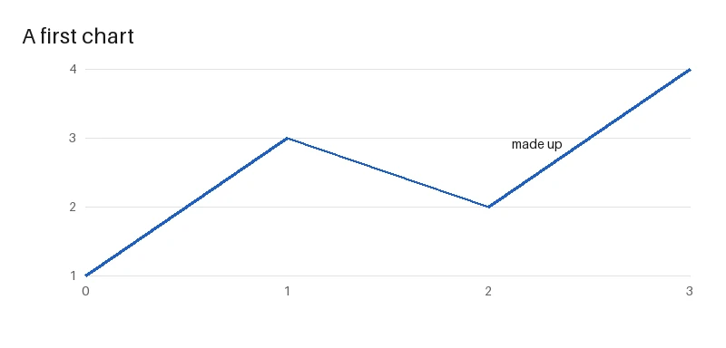
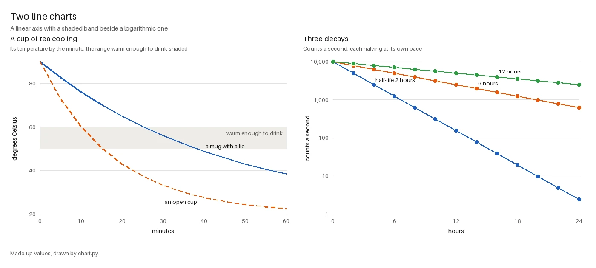
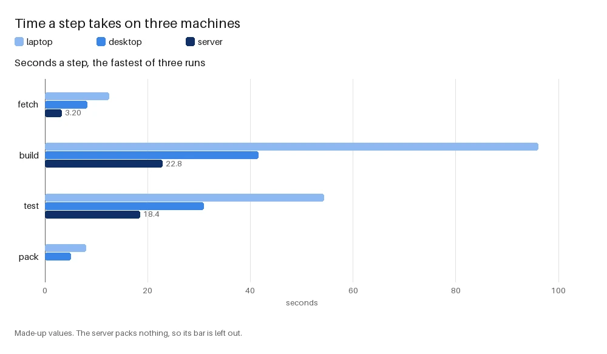
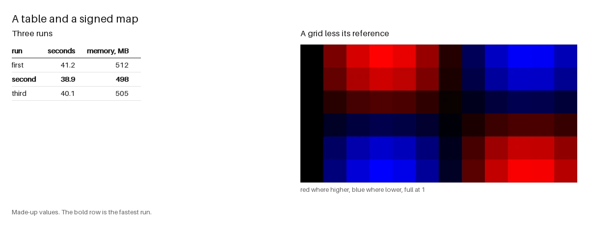
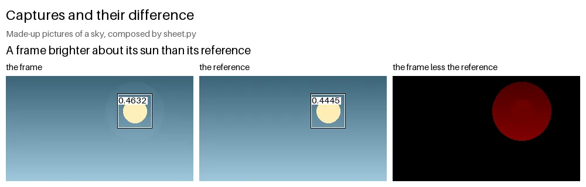

# Sheets of charts and pictures



```bash
pip install pillow
echo '{"title": "A first chart", "width": 800, "panel_height": 300, "panels": [{"kind": "line", "series": [{"label": "made up", "points": [[0, 1], [1, 3], [2, 2], [3, 4]]}]}]}' > first.json
python3 -I chart.py first.json first.webp
```

Two scripts draw sheets of pictures on a white ground from a layout written in JSON, with Python 3
and the imaging library Pillow and nothing else. `chart.py` draws charts of data: line charts on
linear or logarithmic axes, horizontal bars by group, tables and signed maps. `sheet.py` composes
pictures a program has captured, PNG or PFM, side by side with their differences and with boxes that
read the light inside them. Each prints where it placed every panel, so a test or a note can find a
value's pixel on the sheet, and each writes the format its output's name gives, WebP or PNG among
them.

Each example below is its layout in this folder's examples, the command that draws it from the
folder's root, and the picture it draws. The values are made up. The two layouts' keys follow the
examples.

## Line charts

Two panels side by side. The first draws two series on linear axes, one solid and one dashed, each
labeled at its line, `label_side` setting a label below its line where another runs above, over a
band shaded between two values. The second draws three series on a logarithmic axis, `log` on the
axis, every point marked.



```bash
python3 -I chart.py examples/lines.json examples/lines.webp
```

```json
{
  "title": "Two line charts",
  "subtitle": "A linear axis with a shaded band beside a logarithmic one",
  "columns": 2,
  "width": 1400,
  "panel_height": 480,
  "font": 15,
  "panels": [
    {
      "kind": "line",
      "title": "A cup of tea cooling",
      "subtitle": "Its temperature by the minute, the range warm enough to drink shaded",
      "x": {
        "label": "minutes",
        "min": 0,
        "max": 60,
        "ticks": [0, 10, 20, 30, 40, 50, 60]
      },
      "y": {
        "label": "degrees Celsius",
        "min": 20,
        "max": 90
      },
      "bands": [
        {
          "from": 50,
          "to": 60,
          "label": "warm enough to drink"
        }
      ],
      "series": [
        {
          "label": "a mug with a lid",
          "color": "#1f5fbf",
          "points": [[0, 90.0], [5, 82.6], [10, 76.1], [15, 70.2], [20, 64.9], [25, 60.2], [30, 55.9], [35, 52.2], [40, 48.8], [45, 45.8], [50, 43.0], [55, 40.6], [60, 38.5]],
          "label_at": 40
        },
        {
          "label": "an open cup",
          "color": "#e8590c",
          "dash": true,
          "points": [[0, 90.0], [5, 73.0], [10, 60.2], [15, 50.4], [20, 43.0], [25, 37.5], [30, 33.2], [35, 30.0], [40, 27.6], [45, 25.7], [50, 24.4], [55, 23.3], [60, 22.5]],
          "label_at": 30,
          "label_side": "below"
        }
      ]
    },
    {
      "kind": "line",
      "title": "Three decays",
      "subtitle": "Counts a second, each halving at its own pace",
      "x": {
        "label": "hours",
        "min": 0,
        "max": 24,
        "ticks": [0, 6, 12, 18, 24]
      },
      "y": {
        "label": "counts a second",
        "log": true
      },
      "series": [
        {
          "label": "half-life 2 hours",
          "points": [[0, 10000.0], [2, 5000.0], [4, 2500.0], [6, 1250.0], [8, 625.0], [10, 312.5], [12, 156.2], [14, 78.1], [16, 39.1], [18, 19.5], [20, 9.8], [22, 4.9], [24, 2.4]],
          "marks": true,
          "label_at": 4
        },
        {
          "label": "6 hours",
          "points": [[0, 10000.0], [2, 7937.0], [4, 6299.6], [6, 5000.0], [8, 3968.5], [10, 3149.8], [12, 2500.0], [14, 1984.3], [16, 1574.9], [18, 1250.0], [20, 992.1], [22, 787.5], [24, 625.0]],
          "marks": true,
          "label_at": 14
        },
        {
          "label": "12 hours",
          "points": [[0, 10000.0], [2, 8909.0], [4, 7937.0], [6, 7071.1], [8, 6299.6], [10, 5612.3], [12, 5000.0], [14, 4454.5], [16, 3968.5], [18, 3535.5], [20, 3149.8], [22, 2806.2], [24, 2500.0]],
          "marks": true,
          "label_at": 16
        }
      ]
    }
  ],
  "notes": "Made-up values, drawn by chart.py."
}
```

## Bars by group

One panel of horizontal bars, a group a row and a bar a series, the series named in the sheet's
legend. A value of `null` leaves its bar out, and the last bar of each group is labeled with its
value to three figures.



```bash
python3 -I chart.py examples/bars.json examples/bars.webp
```

```json
{
  "title": "Time a step takes on three machines",
  "legend": [
    {
      "label": "laptop",
      "color": "#8db8f0"
    },
    {
      "label": "desktop",
      "color": "#3a86e8"
    },
    {
      "label": "server",
      "color": "#0f2f66"
    }
  ],
  "columns": 1,
  "width": 1000,
  "panel_height": 420,
  "font": 15,
  "panels": [
    {
      "kind": "bars",
      "title": "Seconds a step, the fastest of three runs",
      "series": [
        {
          "label": "laptop",
          "color": "#8db8f0"
        },
        {
          "label": "desktop",
          "color": "#3a86e8"
        },
        {
          "label": "server",
          "color": "#0f2f66"
        }
      ],
      "x": {
        "label": "seconds"
      },
      "groups": [
        {
          "label": "fetch",
          "values": [12.4, 8.1, 3.2]
        },
        {
          "label": "build",
          "values": [96.0, 41.5, 22.8]
        },
        {
          "label": "test",
          "values": [54.2, 30.9, 18.4]
        },
        {
          "label": "pack",
          "values": [
            7.9,
            5.0,
            null
          ]
        }
      ]
    }
  ],
  "notes": "Made-up values. The server packs nothing, so its bar is left out."
}
```

## A table and a signed map

A table with a heavy header and a row drawn bold, beside a map of signed values, red above zero and
blue below, full at its `scale` and black at zero.



```bash
python3 -I chart.py examples/tables.json examples/tables.webp
```

```json
{
  "title": "A table and a signed map",
  "columns": 2,
  "width": 1200,
  "panel_height": 340,
  "font": 15,
  "panels": [
    {
      "kind": "table",
      "title": "Three runs",
      "columns": ["run", "seconds", "memory, MB"],
      "rows": [[
          "first",
          41.2,
          512
        ], [
          "second",
          38.9,
          498
        ], [
          "third",
          40.1,
          505
        ]],
      "bold": [1]
    },
    {
      "kind": "map",
      "title": "A grid less its reference",
      "values": [[0.0, 0.48, 0.84, 1.0, 0.91, 0.6, 0.14, -0.35, -0.76, -0.98, -0.96, -0.71], [0.0, 0.39, 0.68, 0.81, 0.74, 0.49, 0.11, -0.28, -0.61, -0.79, -0.78, -0.57], [0.0, 0.15, 0.27, 0.31, 0.29, 0.19, 0.04, -0.11, -0.24, -0.31, -0.3, -0.22], [-0.0, -0.14, -0.25, -0.3, -0.27, -0.18, -0.04, 0.11, 0.23, 0.29, 0.29, 0.21], [-0.0, -0.38, -0.67, -0.8, -0.73, -0.48, -0.11, 0.28, 0.61, 0.78, 0.77, 0.57], [-0.0, -0.48, -0.84, -1.0, -0.91, -0.6, -0.14, 0.35, 0.76, 0.98, 0.96, 0.71]],
      "scale": 1,
      "label": "red where higher, blue where lower, full at 1"
    }
  ],
  "notes": "Made-up values. The bold row is the fastest run."
}
```

## Captures and their difference

A sheet with its title and subtitle over two pictures of a sky, the second its reference, with a box
on each reading the mean light inside it, written at the box's corner and printed, and the first
less the second in luminance, red where brighter and blue where darker, full at `share` of the
reference's mean. The two PNG files are in this folder; a PFM of linear light is read as well.



```bash
python3 -I sheet.py examples/sheet.json examples/sheet.webp
```

```json
{
  "title": "Captures and their difference",
  "subtitle": "Made-up pictures of a sky, composed by sheet.py",
  "font": 15,
  "size": [320, 180],
  "columns": ["the frame", "the reference", "the frame less the reference"],
  "rows": [
    {
      "title": "A frame brighter about its sun than its reference",
      "panels": [
        {
          "image": "frame.png",
          "boxes": [
            [190, 30, 250, 90]
          ]
        },
        {
          "image": "reference.png",
          "boxes": [
            [190, 30, 250, 90]
          ]
        },
        {
          "signed": ["frame.png", "reference.png"],
          "share": 0.15
        }
      ]
    }
  ]
}
```

## A chart's layout

`chart.py` draws a sheet of data charts on a white ground from a layout in JSON, a title and a
subtitle, panels of line charts, horizontal bars by group, tables and signed maps in a grid, and a
line of notes, and writes it in the format its name's extension gives, WebP or PNG among them. It
needs Pillow and nothing else.

```bash
python3 -I chart.py <layout.json> <sheet.webp>
```

The layout's `title`, `subtitle` and `notes` are lines of text, `legend` a list of `label` and
`color`, `columns` the grid's columns, `width` the sheet's width, `panel_height` a panel's height
and `font` the type's size, and `panels` a list, each with a `kind`, a `title` and a `subtitle`. A
`line` panel's `x` and `y` give an axis's `label`, `min`, `max`, `ticks` and `log`; its `series`
each have `points`, a list of x and y, a `label` drawn at the line at `label_at` on the x axis, a
`color`, `dash` for a dashed line, `marks` to mark every point and `marked` for points of its own;
its `bands` each shade from `from` to `to` on the y axis with a `label`. A `bars` panel's `groups`
each have a `label` and `values`, a bar a series and null for none, its `series` the bars' `label`
and `color`, its `x` an axis, and `value_labels` gives `last`, `all` or `none`. A `table` panel has
`columns`, `rows`, `bold`, the rows drawn heavy by their numbers from 0, and `align`, `left` or
`right` a column. A `map` panel's `values` are rows of signed numbers, red above zero and blue
below, full at `scale` and black at zero, with a `label` under it. A color is a hexadecimal one or
the palette's next. The script prints each panel's place and each chart's plot with its axes'
ranges.

```json
{
  "title": "Time a point by stage", "columns": 2, "width": 1560, "panel_height": 600,
  "legend": [{"label": "513 a side", "color": "#8db8f0"}, {"label": "4,097 a side", "color": "#0f2f66"}],
  "panels": [
    {"kind": "bars", "title": "Time a point", "x": {"label": "nanoseconds a point"},
     "series": [{"color": "#8db8f0"}, {"color": "#0f2f66"}],
     "groups": [{"label": "Noise", "values": [282.4, 143.8]}]},
    {"kind": "line", "title": "Light by height", "x": {"label": "degrees"}, "y": {"log": true},
     "series": [{"label": "the sun", "points": [[5, 4.6], [90, 118]], "dash": true}],
     "bands": [{"from": 5500, "to": 6500, "label": "daylight"}]}
  ],
  "notes": "Drawn from the bench's table."
}
```

## A sheet's layout

`sheet.py` composes a sheet on a white ground from a layout in JSON, rows of panels with a
heading a column and a title a row in dark text, and writes it in the format its name's extension
gives. A layout's `title` and `subtitle` stand over the whole sheet, then a row's title stands first
on a line of its own in a larger type, and the panels' labels under it, the first row's taking the
columns' headings where a panel has none. It needs Pillow.

```bash
python3 -I sheet.py <layout.json> <sheet.png>
```

```json
{
  "font": 16,
  "size": [320, 180],
  "columns": ["frame", "path traced", "frame less it"],
  "rows": [
    {
      "title": "The room at noon",
      "gain": {"mean": "noon/ref.pfm", "to": 0.18},
      "panels": [
        {"image": "noon/frame.pfm", "boxes": [[160, 440, 480, 680]]},
        {"image": "noon/ref.pfm", "label": "4,096 paths a pixel"},
        {"signed": ["noon/frame.pfm", "noon/ref.pfm"], "share": 0.5}
      ]
    }
  ]
}
```

A panel is a capture under `image`, a picture Pillow opens or a PFM of linear light, shown in sRGB
at its gain. Under `signed` it is the first capture less the second in luminance, red where brighter
and blue where darker, full at `share` of the second's mean, on black, the one dark panel of a
sheet. Under `difference` it is the largest
channel's difference of two pictures as shown, times `times`, 4 where none is given, dark on white.
`gain` is a number or the gain that puts a capture's mean luminance at `to`, 1 where none is given.
`crop` is a box in the capture's pixels, left, top, right and bottom, `size` the panel's size in
pixels, the cropped capture's where none is given, and `label` a line over one panel. `gain`,
`crop`, `size` and `share` are given on the layout, a row or a panel, the nearest applying. Paths
are read from the layout's folder.

A box under `boxes` is given in the capture's own pixels and drawn on a capture's panel only, with
the mean luminance in linear light it reads there written at its corner. The script prints the
place of each title, each row's labels and each panel on the sheet, and each box's reading.

## Tests

The tests need Python 3 and Pillow and nothing else, each drawing a made layout and reading the
pixels where the script says it placed a panel, and skip where Pillow is missing. They run from the
folder's root, leaving no bytecode behind.

```bash
python3 -I -B -m unittest discover -s tests -t .
```
